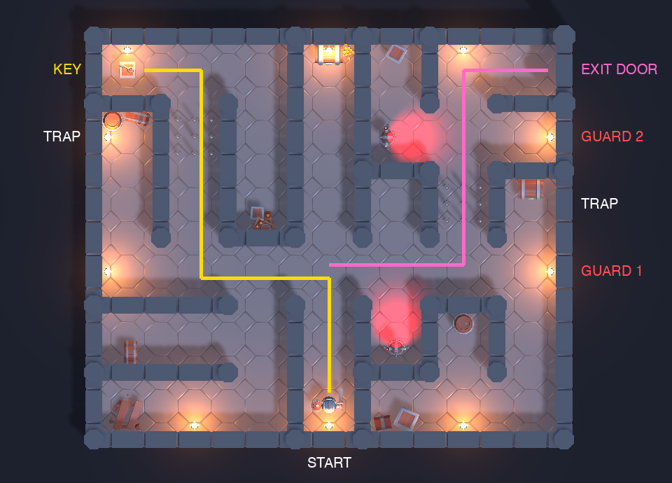

# SWE 585 - HW3: Maze Escape

Batu Demir

A simple third person 3D maze escape game. Unity version: 6000.3.25f1

The project is in the `MazeEscape` folder. Scene: `Assets/Scenes/MazeScene.unity`

## Game Mechanics

**Goal:** Find the key and push it to the exit door.

**Controls:** W/S to move, A/D to turn, M for music, R to restart.

**Player:** A knight with a Rigidbody. The camera follows it from behind.

**Key:** A crate with a key on it. It has a Rigidbody, so it is affected by gravity and collisions. The player pushes it by walking into it.

**Door:** The gate at the top right corner. When the key collides with it (`OnCollisionEnter`), the door opens and the player wins.

**Trap:** Spikes that come out of the floor and go back periodically (coroutine). If the player is on the trap while the spikes are up, he dies.

**Guards:** Two skeletons that walk between two points (coroutine). If the player is in front of a guard and too close, he fails. Passing behind a guard is safe.

**Music:** Background music that can be toggled with the button at the top right or the M key.

**End of game:** After winning or dying, a panel asks for another round (Play Again / Quit).

## Map

Yellow path goes to the key, pink path goes to the exit door.

## Assets

- KayKit Dungeon, Adventurers and Skeletons packs by Kay Lousberg (CC0)
- Music: "Mysterious Cave Theme (Loop)" by beardalaxy, OpenGameArt (CC0)
